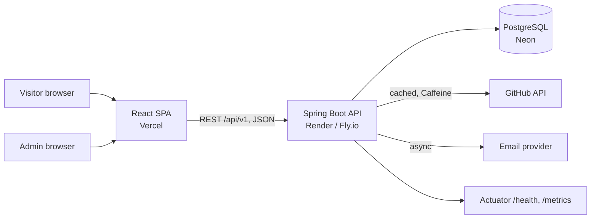

# Architecture

## Style: layered, feature-based modular monolith

One Spring Boot application, one PostgreSQL database, one React SPA. Each backend feature
(`project`, `skill`, `github`, `contact`, `auth`) owns its controller, service, repository, DTOs and entities.
See [ADR 0001](adr/0001-modular-monolith.md) for why this is not microservices.

## Request flow (public project list)

`GET /api/v1/projects` -> Controller (validates params) -> Service (business rules, maps entity to DTO) -> Repository (Spring Data JPA) -> PostgreSQL.
Entities never leave the service layer; controllers only see DTOs.

## Cross-cutting concerns

| Concern | Approach |
|---|---|
| Errors | `@RestControllerAdvice` returning RFC 9457 Problem Details |
| Validation | Bean Validation on every request DTO |
| Security | BCrypt, short-lived JWT, `/api/v1/admin/**` secured, CORS limited to the frontend origin |
| Schema changes | Flyway only; Hibernate `ddl-auto=validate` |
| Config | Environment variables, Spring profiles `dev`, `test`, `prod` |
| Observability | Actuator + Micrometer, public `/status` page |
| Testing | Unit (Mockito), slice (`@WebMvcTest`), integration (Testcontainers) |

## API surface (planned, v1)

| Method | Path | Access |
|---|---|---|
| GET | `/api/v1/projects`, `/api/v1/projects/{slug}` | Public |
| GET | `/api/v1/skills` | Public |
| POST | `/api/v1/contact` | Public, rate limited |
| GET | `/api/v1/github/stats` | Public, cached |
| POST | `/api/v1/auth/login` | Public |
| POST/PUT/DELETE | `/api/v1/admin/projects/**`, `/api/v1/admin/skills/**` | Admin (JWT) |
| GET | `/api/v1/admin/messages` | Admin (JWT) |
