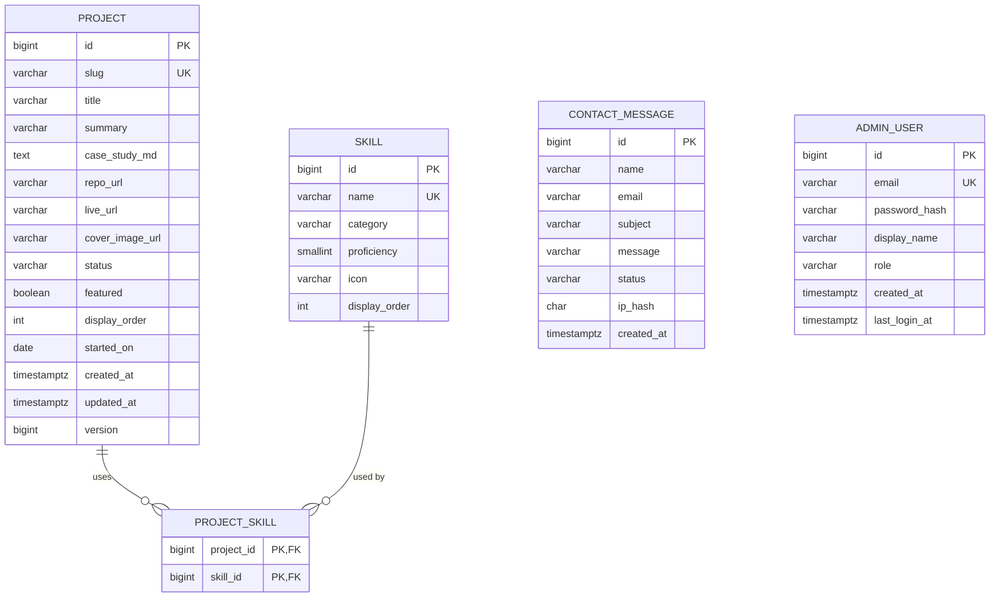

# Database schema

PostgreSQL, managed with Flyway. The source of truth is
[`V1__init.sql`](../backend/src/main/resources/db/migration/V1__init.sql).

## ER diagram

`contact_message` and `admin_user` are intentionally standalone: no foreign keys link them to the content tables.

## Tables

| Table | Purpose | Notes |
|---|---|---|
| `project` | Portfolio projects and Markdown case studies | `slug` is the public URL id; `status` is DRAFT / PUBLISHED / ARCHIVED |
| `skill` | Technologies you know | `category` groups them on the Skills section; `proficiency` is 1 to 5 |
| `project_skill` | Join table (many-to-many) | Composite primary key, cascade delete |
| `contact_message` | Messages from the contact form | `ip_hash` instead of raw IP for privacy |
| `admin_user` | Admin CMS login | BCrypt hash only |

## Design decisions (be ready to explain these in interviews)

1. **Identity BIGINT keys.** Simple, index-friendly and the standard choice for a single database. UUIDs would add size with no benefit here.
2. **Slug as public identifier.** URLs read `/projects/devfolio`, and the numeric id stays internal. A CHECK constraint enforces the slug format.
3. **Status column, not delete.** Drafts stay hidden from the public API and archived projects keep their history.
4. **`version` column.** Supports JPA `@Version` optimistic locking, so two admin tabs cannot silently overwrite each other.
5. **CHECK constraints for enums.** The database rejects bad values even if application code has a bug. In Java, map them to enums with `@Enumerated(EnumType.STRING)`.
6. **Composite PK on `project_skill`.** Prevents duplicate pairs without needing an extra id. The extra index on `skill_id` speeds up "projects using skill X" filters.
7. **Hashed IP.** Enough for rate limiting and abuse checks, without storing personal data.
8. **`TIMESTAMPTZ` everywhere.** Avoids time zone bugs.
9. **No seed admin in the migration.** Credentials come from environment variables at startup, never from Git.
10. **Case study stored as Markdown text.** Easy to edit in the admin CMS and render on the frontend; Mermaid blocks work for free.

## Known gap (on purpose, for you to solve in Week 2)

`updated_at` has a default for inserts but nothing refreshes it on update. Handle it in the entity with Hibernate's `@UpdateTimestamp` (or `@PreUpdate`) and cover it with a test.

## Planned later migrations

- `V2__page_view.sql`: privacy-friendly analytics (path, day, count; no personal data) in Week 5.
- `V3__experience_education.sql`: only if you want the Experience section editable from the CMS.

## Mapping to JPA (Week 2 preview)

- `Project` has `@ManyToMany` to `Skill` through `project_skill`, with `Set<Skill>` and `FetchType.LAZY`.
- Avoid the N+1 problem on the list endpoint with `@EntityGraph` or a fetch join, and prove it with a test.
